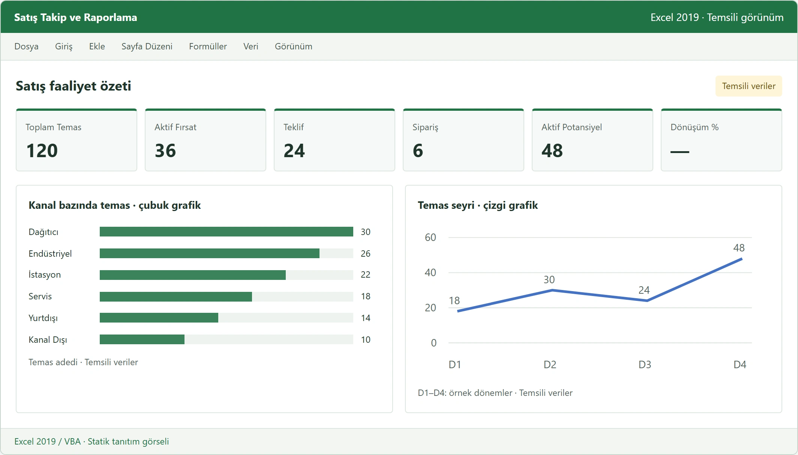
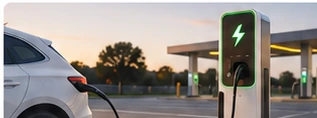
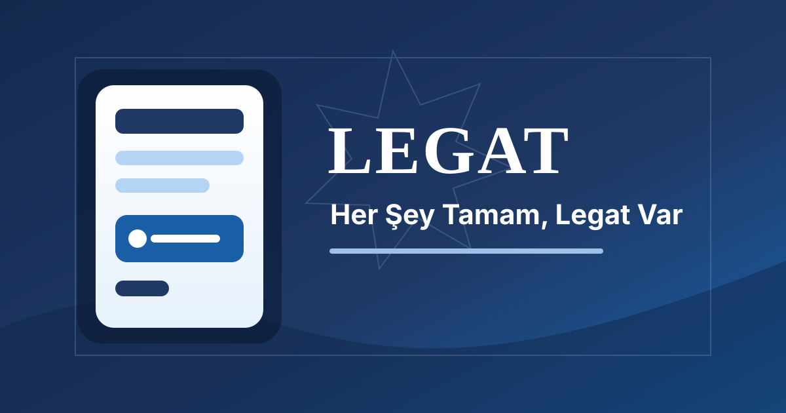

  <section class="home-hero" aria-labelledby="home-title">
    

      <h1 id="home-title">Merhaba, ben Mustafa Çelik.</h1>
      
18 yıllık profesyonel deneyimimin 15 yılını satış, müşteri yönetimi ve iş geliştirme alanlarında edindim. Enerji sektöründeki deneyimimi; veri analizi ve yapay zekâ destekli dijital araçlarla tamamlıyorum.

      <h2 class="home-focus-label">Odak Alanlarım</h2>
      <ul class="home-focus-tags" aria-label="Odak alanları">
        <li>Satış ve müşteri yönetimi</li><li>İş geliştirme</li><li>Enerji ve mobilite</li><li>Veri analizi ve raporlama</li><li>Yapay zekâ destekli araçlar</li>
      </ul>
      

        <a class="home-button home-button--primary" href="/projects/">Projelerimi İncele →</a>
        <a class="home-button" href="/cv/">Özgeçmiş</a>
      

    

    

  </section>

  <section class="home-focus" aria-labelledby="home-focus-title">
    <h2 id="home-focus-title" class="home-sr-only">Uzmanlık alanları</h2>
    

      <article class="home-focus-card"><svg viewBox="0 0 24 24" aria-hidden="true"><path d="M4 7h16v13H4zM9 7V4h6v3M4 12h16M10 12v3h4v-3"/></svg><h3>Kurumsal Satış ve İş Geliştirme</h3>
Müşteri ilişkileri ve satış süreçleri.
</article>
      <article class="home-focus-card"><svg viewBox="0 0 24 24" aria-hidden="true"><path d="M13 2L5 14h6l-1 8 9-13h-7z"/></svg><h3>Enerji Sektörü ve Mobilite</h3>
Enerji ve elektrikli araç şarj ekosistemi.
</article>
      <article class="home-focus-card"><svg viewBox="0 0 24 24" aria-hidden="true"><path d="M7 7h10v10H7zM9 1v6m6-6v6M9 17v6m6-6v6M1 9h6m-6 6h6M17 9h6m-6 6h6M10 10h4v4h-4z"/></svg><h3>Yapay Zekâ Destekli Araçlar</h3>
İş ihtiyaçlarına yönelik dijital çözümler.
</article>
      <article class="home-focus-card"><svg viewBox="0 0 24 24" aria-hidden="true"><path d="M3 3v18h18M7 16v-5m5 5V7m5 9V3"/></svg><h3>Veri Analizi ve Raporlama</h3>
Veriyi düzenleme, karşılaştırma ve raporlama.
</article>
    

  </section>

  <section class="home-projects" aria-labelledby="home-projects-title">
    

İhtiyaçtan çözüme
<h2 id="home-projects-title">Öne çıkan çalışmalar</h2>
<a href="/projects/">Tüm projeler →</a>

    

      <article class="home-project-card">
        

        
Satış operasyonları<h3>Kurumsal Satış Takip ve Raporlama Sistemi</h3>
Temas, fırsat, teklif ve sipariş süreçlerini izlemek için geliştirilen Excel 2019 / VBA çözümü.
<a href="/portfolyo/kurumsal-satis-takip.html">Projeyi incele →</a>

      </article>
      <article class="home-project-card">
        

        
Veri analizi<h3>E.A. Şarj Ekosistemi Analizi</h3>
Şarj istasyonu verilerini dönemler arasında karşılaştıran büyüme, dağılım ve değişim analizi.
<a href="/portfolyo/sarjekosistemianaliz.html">Projeyi incele →</a>

      </article>
      <article class="home-project-card">
        

        
Dijital üretkenlik<h3>LEGAT</h3>
Görev, not, hatırlatıcı ve takvim akışlarını birleştirmeyi hedefleyen kişisel üretkenlik uygulaması.
<a href="/portfolyo/legat.html">Projeyi incele →</a>

      </article>
    

  </section>

  <aside class="home-note" aria-label="Diğer bağlantılar">
Enerji, teknoloji ve iş geliştirme üzerine notlarımı <a href="/blog/">blogda</a> paylaşıyorum.
<a href="/iletisim/">İletişime geç →</a></aside>

