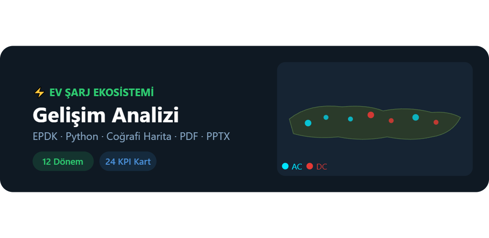
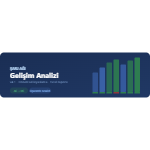
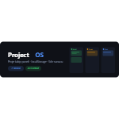

<!-- markdownlint-disable MD033 -->
<!-- Inline HTML is intentionally used here for the custom project card grid. -->

Bu bölümde; satış, müşteri yönetimi, veri analizi, günlük iş akışları ve enerji sektörü odağında geliştirdiğim uygulama ve araç çalışmalarını paylaşıyorum. Çalışmaların önemli bir kısmı, yapay zeka destekli üretim ve vibecoding yaklaşımıyla; pratik ihtiyaçlara hızlı, anlaşılır ve uygulanabilir çözümler üretme amacıyla hazırlanmıştır.

  

    

      
    

    

      <h3 class="custom-project-card-title archive__item-title">LEGAT</h3>
      

        Görev, not, hatırlatıcı, takvim ve profil akışlarını tek uygulamada birleştirmeyi hedefleyen kişisel üretkenlik uygulaması.
      

      <a href="/portfolyo/legat.html" class="custom-align-btn">Projeyi İncele</a>
    

  

  

    

      <svg viewBox="0 0 360 82" width="100%" height="74" role="img" aria-label="Excel 2019 satış raporu temsili görseli" xmlns="http://www.w3.org/2000/svg">
        <rect width="360" height="82" rx="4" fill="#f1f6f3"/>
        <rect width="360" height="18" fill="#217346"/>
        <text x="12" y="13" fill="white" font-family="Arial, sans-serif" font-size="11">EXCEL 2019 · SATIŞ TAKİBİ</text>
        <path d="M16 66H158" stroke="#c4d3ca"/><path d="M30 65V42M60 65V32M90 65V48M120 65V26" stroke="#217346" stroke-width="16"/>
        <path d="M187 60L223 48L260 52L300 30L340 24" fill="none" stroke="#4472c4" stroke-width="3"/>
        <text x="187" y="75" fill="#42564a" font-family="Arial, sans-serif" font-size="10">Temsili veriler</text>
      </svg>
    

    

      <h3 class="custom-project-card-title archive__item-title">Kurumsal Satış Takip ve Raporlama Sistemi</h3>
      

        Kurumsal satış temaslarını, fırsatları, teklif ve sipariş süreçlerini izlemek için yapay zekâ desteğiyle geliştirilen Excel 2019 / VBA çözümü.
      

      <a href="/portfolyo/kurumsal-satis-takip.html" class="custom-align-btn">Projeyi İncele</a>
    

  

  

    

      
    

    

      <h3 class="custom-project-card-title archive__item-title">VibeTrack</h3>
      

        Ruh haline göre odak odaları, müzik ve zamanlayıcı akışıyla çalışma ritmini sade biçimde destekleyen verimlilik uygulaması.
      

      <a href="/portfolyo/vibetrack.html" class="custom-align-btn">Projeyi İncele</a>
    

  

  

    

      
    

    

      <h3 class="custom-project-card-title archive__item-title">E.V.C.P. DaTAker</h3>
      

        Şarj istasyonlarına ait konum ve teknik verileri toplayarak analiz çalışmaları için düzenli veri kaynağı hazırlayan araç.
      

      <a href="/portfolyo/evcpdataker.html" class="custom-align-btn">Projeyi İncele</a>
    

  

  

    

      
    

    

      <h3 class="custom-project-card-title archive__item-title">E.A. Şarj Ekosistemi Analizi</h3>
      

        Şarj istasyonu verilerini dönemler arasında karşılaştırarak büyüme, dağılım ve değişim eğilimlerini görünür kılan analiz çalışması.
      

      <a href="/portfolyo/sarjekosistemianaliz.html" class="custom-align-btn">Projeyi İncele</a>
    

  

  

    

      
    

    

      <h3 class="custom-project-card-title archive__item-title">Gelişim Raporu V1</h3>
      

        EPDK verileriyle iki dönemli şarj noktası değişimini raporlayarak temel pazar gelişimini hızlı değerlendirmeyi sağlayan araç.
      

      <a href="/portfolyo/gelisimraporu.html" class="custom-align-btn">Projeyi İncele</a>
    

  

  

    

      
    

    

      <h3 class="custom-project-card-title archive__item-title">ProjectOS</h3>
      

        Satış ve proje süreçlerini tek panelde izleyerek fırsat, görev ve ilerleme takibini daha ölçülebilir kılan yönetim aracı.
      

      <a href="/portfolyo/projectos.html" class="custom-align-btn">Projeyi İncele</a>
    

  

