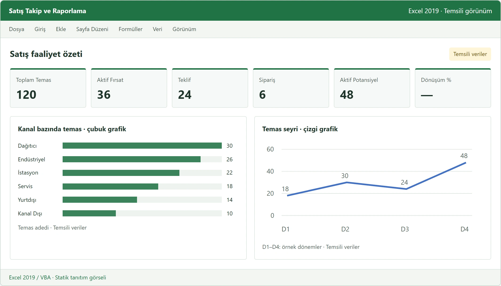
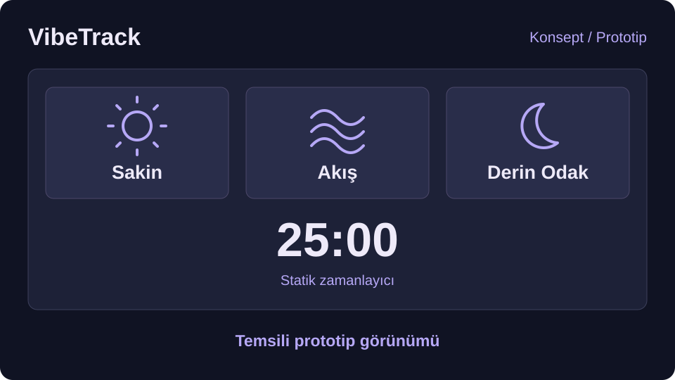
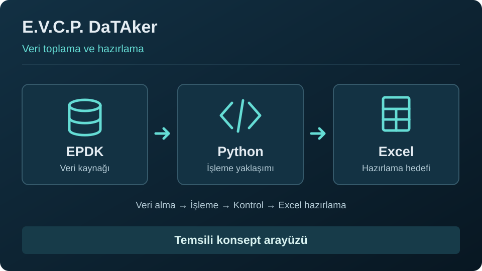
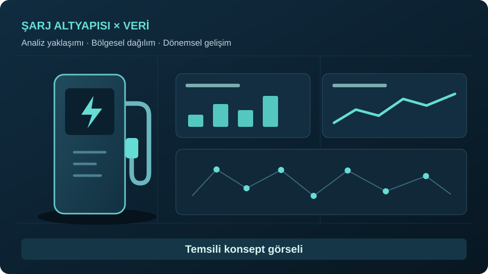
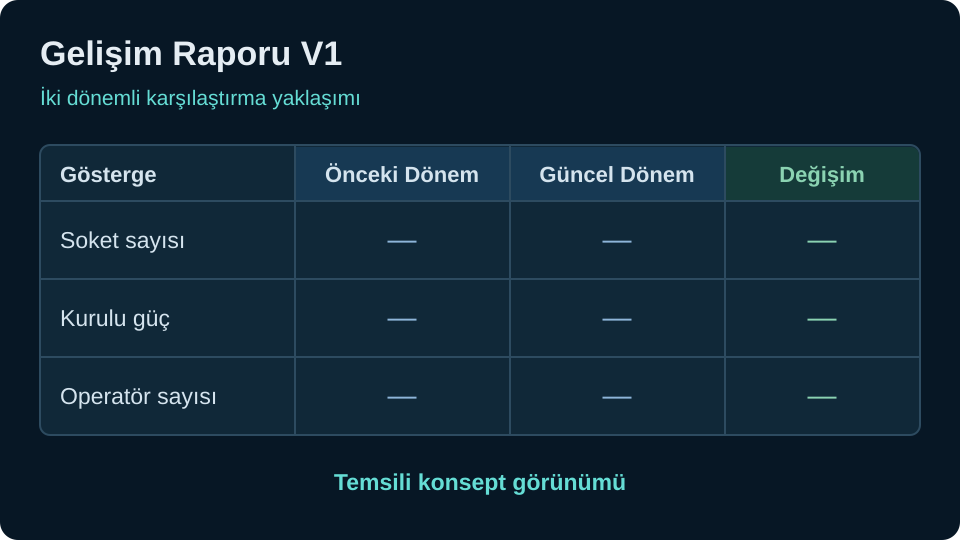
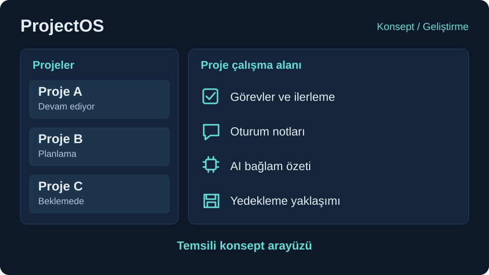

<!-- markdownlint-disable MD033 -->
<!-- Inline HTML is intentionally used here for the custom project card grid. -->

<section class="projects-intro" aria-labelledby="projects-intro-title">
  <h2 id="projects-intro-title">Gerçek ihtiyaçlardan doğan çözümler</h2>
  
Satış, veri analizi ve günlük iş akışlarını desteklemek için geliştirdiğim uygulama ve araç çalışmaları.

</section>

  

    

      
    

    

      <h3 class="custom-project-card-title archive__item-title">LEGAT</h3>
      

        Görev, not, hatırlatıcı, takvim ve profil akışlarını tek uygulamada birleştirmeyi hedefleyen kişisel üretkenlik uygulaması.
      

      <a href="/portfolyo/legat.html" class="custom-align-btn">Projeyi İncele</a>
    

  

  

    

      
    

    

      <h3 class="custom-project-card-title archive__item-title">Kurumsal Satış Takip ve Raporlama Sistemi</h3>
      

        Kurumsal satış temaslarını, fırsatları, teklif ve sipariş süreçlerini izlemek için yapay zekâ desteğiyle geliştirilen Excel 2019 / VBA çözümü.
      

      <a href="/portfolyo/kurumsal-satis-takip.html" class="custom-align-btn">Projeyi İncele</a>
    

  

  

    

      
    

    

      <h3 class="custom-project-card-title archive__item-title">VibeTrack</h3>
      

        Ruh haline göre odak odaları, müzik ve zamanlayıcı akışıyla çalışma ritmini sade biçimde destekleyen verimlilik uygulaması.
      

      <a href="/portfolyo/vibetrack.html" class="custom-align-btn">Projeyi İncele</a>
    

  

  

    

      
    

    

      <h3 class="custom-project-card-title archive__item-title">E.V.C.P. DaTAker</h3>
      

        Şarj istasyonlarına ait konum ve teknik verileri toplayarak analiz çalışmaları için düzenli veri kaynağı hazırlayan araç.
      

      <a href="/portfolyo/evcpdataker.html" class="custom-align-btn">Projeyi İncele</a>
    

  

  

    

      
    

    

      <h3 class="custom-project-card-title archive__item-title">E.A. Şarj Ekosistemi Analizi</h3>
      

        Şarj istasyonu verilerini dönemler arasında karşılaştırarak büyüme, dağılım ve değişim eğilimlerini görünür kılan analiz çalışması.
      

      <a href="/portfolyo/sarjekosistemianaliz.html" class="custom-align-btn">Projeyi İncele</a>
    

  

  

    

      
    

    

      <h3 class="custom-project-card-title archive__item-title">Gelişim Raporu V1</h3>
      

        EPDK verileriyle iki dönemli şarj noktası değişimini raporlayarak temel pazar gelişimini hızlı değerlendirmeyi sağlayan araç.
      

      <a href="/portfolyo/gelisimraporu.html" class="custom-align-btn">Projeyi İncele</a>
    

  

  

    

      
    

    

      <h3 class="custom-project-card-title archive__item-title">ProjectOS</h3>
      

        Satış ve proje süreçlerini tek panelde izleyerek fırsat, görev ve ilerleme takibini daha ölçülebilir kılan yönetim aracı.
      

      <a href="/portfolyo/projectos.html" class="custom-align-btn">Projeyi İncele</a>
    

  

